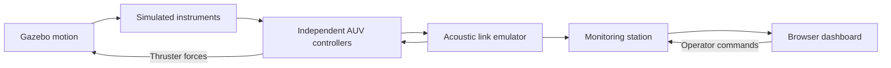

# Tidewatch

Tidewatch is an underwater swarm simulation with two missions: protect a moving diver or explore a survey area on its own. Three AUVs run independent Python controllers. Gazebo calculates their motion, and a local browser dashboard shows the estimates received over a simulated acoustic link.

This is a simulation project. It does not yet contain hardware drivers, trained detection models, or validated physical diver protection.

## Run it

```bash
source /opt/ros/lyrical/setup.bash
python3 scripts/run_simulation.py
```

Open **http://127.0.0.1:8080**. Choose **Diver protection** or **Autonomous survey** in the dashboard. Start, pause and reset apply to Gazebo and the mission.

Useful options:

```bash
python3 scripts/run_simulation.py --mode explore
python3 scripts/run_simulation.py --rviz
python3 scripts/run_simulation.py --headless --duration 60
python3 scripts/run_simulation.py --seed 11 --config config/mission.yaml
python3 scripts/stop_simulation.py
```

The runner needs ROS 2, Gazebo Sim, `ros_gz_bridge`, `ros_gz_interfaces`, `sensor_msgs_py`, NumPy and PyYAML. This workspace has ROS 2 Lyrical; source the matching ROS installation on another machine. RViz and MQTT are optional. `--no-mqtt` disables the broker; `--no-dashboard` disables the web server. The runner isolates its ROS graph with domain 42 and Gazebo partition `tidewatch_sim`. Override these with `--domain` and `--partition` for another instance.

For a ROS package installation:

```bash
colcon build --symlink-install
source install/setup.bash
ros2 launch underwater_system tidewatch.launch.py
```

## Move the diver

Select **Manual control**, then hold a direction button or use the keyboard:

| Input | Movement |
| --- | --- |
| W / up arrow | North |
| S / down arrow | South |
| A / left arrow | West |
| D / right arrow | East |
| Q | Descend |
| E | Ascend |
| Space | Stop |

Release the input to stop. Keyboard controls ignore text and number inputs. Losing focus clears held movement. The controller also stops manual motion if no fresh input arrives for 1.2 seconds. Combined speed is limited to 0.65 m/s; the diver stays inside the test area's horizontal and depth limits. **Scripted route** restores the automatic diver path.

The AUVs remain autonomous. In protection mode they follow the diver's measured beacon and adjust their escort positions. In survey mode their targets are independent of the diver.

## What the simulation does

Each AUV receives noisy navigation, sonar contacts, measured terrain rays and a hydrophone frame. It classifies contacts locally, keeps position and velocity estimates, chooses a mission target, and computes a bounded velocity command. A propulsion controller turns that command into eight individual thruster forces. Gazebo integrates those forces with buoyancy, drag and water current.

Protection uses a predictive escort formation. The planner evaluates contact motion and closest approach, then rotates the guard positions toward the highest geometric risk. It keeps the escort radius, limits rotation speed and adjusts goals around nearby contacts. Local collision avoidance still runs underneath the planner. If the diver beacon becomes stale, the planner holds its last safe anchor rather than chasing an expired position.

Survey uses measured frontier coverage. Each AUV owns an angular sector of the configured region. It ranks targets by expected new coverage, travel distance and nearby peer claims, holds a target long enough to inspect it, and moves on when it reaches or stalls at that target. Coverage increases only from measured sonar endpoints. Time, travel and navigation-uncertainty limits can send a unit back to its survey home position. These are simulation budgets, not a calibrated battery model.

The acoustic emulator applies TDMA slots, byte limits, delay, loss and report expiry. Raw hydrophone audio stays on the local sensor path. The station receives compact contact, map and mission reports, builds the shared map and sends dashboard telemetry. Losing one link does not stop the other edge controllers.



Coordinates are local ENU: x east, y north, z up. Underwater z is negative. Ground truth is available to the instrument emulator and evaluator; it is excluded from edge navigation, association and classification inputs.

## Deterrent speakers and early warning

Each AUV carries an acoustic deterrent speaker. From its own tracked contacts and the diver beacon, an AUV predicts when a classified marine-life contact will enter a 9 m warning radius around the diver. If that is within 30 s and the animal is inside the speaker's 24 m range, it sounds the lowest source level that should reach the animal (135-175 dB re 1 uPa at 1 m). The received level at the diver is capped, and a 6 s on / 4 s off duty cycle limits exposure. Vehicles and unknown objects are not deterred; they raise alerts and move the escort formation instead.

Simulated animals flee from the sound field of active speakers, habituate to repeated exposure and drift back to their route when it stops. Thresholds are in `config/mission.yaml` under `deterrent`. They are illustrative simulation values, not species audiograms or diver-safety limits. Setting `deterrent.enabled: false` gives a baseline for comparison.

Protection alerts now look 40 s ahead and report `time_to_zone_s` and a `warning_stage` (`early`, `imminent`, `inside`). The offline evaluation adds `deterrent_activations`, `min_animal_diver_distance_m`, `protected_zone_breach_s` and `warning_lead_times_s`.

## Contacts and wildlife

The scene includes a diver, a moving vehicle, fish, a large marine-life crossing, a rock hazard and an unknown object. The large animal is a synthetic wildlife encounter; it is not a validated shark model.

Collision avoidance includes moving marine life, vehicles, obstacles and unknown contacts. It predicts nearby crossings, adds clearance for measurement uncertainty and changes course while respecting the speed limit. In protection mode the station evaluates approach risk to the diver. In survey mode it evaluates risk to the AUVs.

The contact log shows classification separately from proximity risk. A detected vehicle is not automatically hostile. Fish and sharks are wildlife; the response here is clearance and avoidance. Reliable shark identification needs real sonar examples and a separately validated classifier.

## Code and folders

| Path | Purpose |
| --- | --- |
| `config/` | Mission settings and RViz layout; one source of configuration |
| `src/underwater_system/underwater_system/` | Python algorithms and ROS adapters |
| `src/underwater_system/dashboard/` | HTML, CSS and JavaScript operations console |
| `src/underwater_system/worlds/` | Gazebo scene and existing mesh assets |
| `scripts/` | Run, stop and validation commands |
| `tests/` | Algorithm, control and integration checks |
| `datasets/` | Data sources and recording instructions |
| `results/` | Evaluation reports and previews |

Runtime logs and resolved settings go in `.runtime/`. Each new run replaces `results/live.jsonl`; copy it before another experiment if you need the samples. Workspace-local MQTT dependencies go in `.tools/`. Both hidden folders are ignored by Git. Empty source folders were removed, configuration was consolidated in `config/`, and the old `artifacts/` report was moved to `results/evaluation_legacy.json`.

The main Python modules are:

| File | Responsibility |
| --- | --- |
| `mission.py` | Protection and survey goals; uses estimates only |
| `core.py` | Local avoidance, tracking, mapping, acoustic channel and offline simulator |
| `perception.py` / `acoustics.py` | Sonar feature classification and acoustic analysis |
| `propulsion.py` | Body feedback and eight-thruster force allocation |
| `controls.py` | Validated commands and manual-input timeout |
| `recordings.py` | Optional local WAV replay |
| `ros_nodes.py` | Gazebo instruments, AUV processes, mesh and station |
| `dashboard.py` | Dashboard HTTP server and command queue |
| `evaluate.py` | Repeatable numerical simulation reports |

For the physical model, keep the mission planner and replace the instrument adapter with measured sensor packets and the Gazebo thrust publisher with an actual actuator driver. `EdgeAgent.step()` already accepts estimated pose, velocity, contacts, measured rays, uncertainty and delivered peer reports. Hardware folders will be added when those drivers exist.

## Data and model status

The default run uses synthetic sensors and an untrained numeric classifier. The map starts empty. Unobserved cells stay unknown. Displayed uncertainty and classification confidence are separate values. Power is an illustrative propulsion estimate, not measured battery use.

Public data sources, their limits, and the WAV replay option are listed in [datasets/README.md](datasets/README.md). No field recordings or pretrained model weights are bundled. Sonar-image datasets need a separate image adapter; they cannot be dropped into the current ten-feature classifier.

## Check the changes

```bash
PYTHONPATH=src/underwater_system python3 -m pytest -q tests
PYTHONPATH=src/underwater_system python3 -m underwater_system.evaluate \
  --mode both --duration 60 --output results/dual_mode_evaluation.json
PYTHONPATH=src/underwater_system python3 -m underwater_system.evaluate \
  --duration 60 --output results/evaluation.json
```

The first report checks protection, survey and mode switching. The second compares nominal loss, high packet loss and an acoustic outage/reconnection. These run without ROS or Gazebo and use numerical motion plus synthetic sensing.

With GJS installed, `gjs tests/test_dashboard_logic.js` checks dashboard mode acknowledgement, diver controls, stop behavior and telemetry handling using DOM/canvas fixtures. Source ROS before the Python suite to include the ROS callback tests; they do not start a ROS graph. Optional TorchScript tests require PyTorch.

For a running Gazebo mission, use `python3 scripts/validate_live.py --controls`. Native physics checks run separately with `python3 scripts/validate_physics.py`. Earlier Gazebo and browser reports in `results/` describe their recorded revisions; they do not validate this upgrade.

The current restricted development environment blocks network sockets and its Firefox launcher fails confinement checks. HTTP-handler, JavaScript logic and numerical checks can run here; a fresh live Gazebo/browser validation still needs a normal local session.
